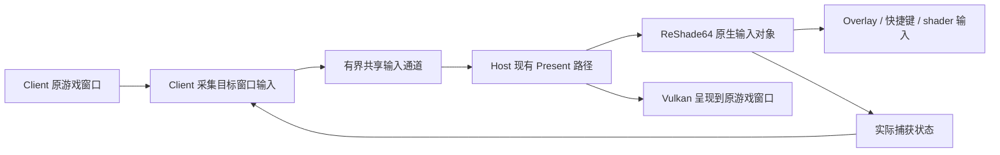

# ReShade 原游戏窗口与无 Presenter 输入方案调查

> 后续执行状态：独立 Windows 输入/跨进程验证已通过，外部输入已接入实验分支。
> 当前实现与实机安装范围见 [生产接入实验说明](RESHADE-EXTERNAL-INPUT-EXPERIMENT.md)。
> 以下调查是原始阶段记录；完整构建和下载证据另行记录，不能当作 gameplay 通过声明。
> 实际实现持续传递面板关闭时的输入，以支持效果热键及 input 源 shader。

状态：**INVESTIGATED — 原型尚未实现，性能与实机兼容尚未验证**。
调查日期2026-10-12；保留 Steam 已验收的 `83ec0fca6f5fb2f1` 二进制、配置和当前生产补丁。
本次仅新增静态分析工具、证据元数据与设计文档；不修改用户 DLL、main、VERSION 或 Release。

**结论：使用游戏原窗口不要求使用 ReShade32。** DLL 位数由加载进程决定；真实 Vulkan 渲染在
x64 Host 内时，仍应使用 ReShade64。可研究省掉 Host 子窗口和它的输入线程，但必须另外解决
跨进程输入。现有标准 DLL 的公开 API 不提供完整的原生输入提交接口。

## 直接检查两份用户 DLL

仅读取 PE、导入导出、资源版本、字符串和反汇编；没有 LoadLibrary、执行、改写或分发样本。
版本标识不等于完整构建来源证明；公开源码与样本控制流的对应是语义证据，不是可复现构建核验。

| 文件 | 架构 | 文件/产品版本 | SHA-256 |
| --- | --- | --- | --- |
| ReShade32.dll | x86 PE32 | 6.0.1.1824 | `613ec48122a7df9547bad83bdfcd07a41397424e8a6a79f1abd885cf3bf5e1a0` |
| ReShade64.dll | x64 PE32+ | 6.0.1.1823 | `8d160b94e0b6323753f1964e51fe9fdee52766e1273cddff8e134a38a47cda25` |

两份文件都包含 Vulkan 层入口、ReShade API 和同一输入拒绝日志：
`Cannot capture input for window ... created by a different process.`
两份 PE 均有457个具名导出，独立 GNU objdump 结果与 Python 工具解析一致。
文件版本最后一位不同，不能仅据此认定两个架构有兼容性故障。

反汇编直接确认：先调用 GetWindowThreadProcessId，随后调用 GetCurrentProcessId，比较 PID。
相等跳向注册路径；不等写入空 shared_ptr 返回值。具体样本 RVA：

| 位置 | x86 样本 | x64 样本 |
| --- | --- | --- |
| 注册函数入口 | 0x51C81 | 0x60650 |
| 窗口 PID 查询 | 0x51CB1 | 0x60676 |
| 当前 PID 查询 | 0x51CB7 | 0x6067C |
| PID 相等分支 | 0x51CC0 → 0x51D17 | 0x60689 → 0x606DB |
| 拒绝路径的空结果写入 | 0x51CFF、0x51D07 | 0x606CF、0x606D2 |

这些地址只有静态样本意义，不被采用为运行时补丁目标。工具只在完整文件哈希匹配时输出该注释，
并再次检查条件分支与目标。未知版本仍只报告通用 PE 元数据，不猜测函数位置。

[32位元数据](reshade-input-evidence/reshade32-report.json)、
[64位元数据](reshade-input-evidence/reshade64-report.json)、
[源码哈希清单](reshade-input-evidence/upstream-source-manifest.json)。原始反汇编和样本留在工作目录，
不包含在仓库或构建 ZIP。运行 `python scripts/inspect_reshade_input.py <DLL>` 可重现静态报告。

## DLL 位数、呈现窗口与渲染进程是三个概念

| 渲染位置 | ReShade 选择 | 使用 Client 原窗口是否改变 DLL 位数 |
| --- | --- | --- |
| x64 Host 的 Vulkan/DXVK | ReShade64 | 不改变 |
| x86 Host 的 Vulkan/DXVK | ReShade32 | 不改变；Host 与 Client 仍是不同 PID |
| x86 Client 的真实渲染设备 | ReShade32 | 可以本地收集窗口输入，但这不是当前 LDB 的 Vulkan 渲染位置 |

Windows HWND 可以跨进程传递。当前关闭 Presenter 的 Host 把游戏 HWND 传入后端；
ReShade 的 Vulkan `vkCreateWin32SurfaceKHR` 保存原 HWND，swapchain/runtime 在 Host 中建立。
它不会因窗口属于 x86 Client 就把渲染切换到 Client，也不会据此加载 x86 DLL。

把 ReShade32 放在 Client 的 Vulkan 加载链中，不能观察到另一个进程的 Vulkan 调用。
把它改为 D3D9 代理并包在 LDB Client 外面，是另一个方案：ReShade 通过代理生成的渲染命令
需要经过 Bridge，增加 Client 内存、API/IPC 工作和兼容范围。这不是仅替换输入路径，不能默认
认为它更快，也不能把它当作保留现有 x64 Vulkan ReShade 的等价优化。

## 对照固定 ReShade 源码：两个输入障碍

源码固定在 crosire/reshade v6.0.1 的提交
[`1c952ec211a91b9ebbf9042e23a4a810feba44ff`](https://github.com/crosire/reshade/tree/1c952ec211a91b9ebbf9042e23a4a810feba44ff)。

1. [input.cpp](https://github.com/crosire/reshade/blob/1c952ec211a91b9ebbf9042e23a4a810feba44ff/source/input.cpp#L39)
   的 register_window 按 PID 拒绝其他进程窗口。两份样本的反汇编与该控制流相符。
2. [input.cpp](https://github.com/crosire/reshade/blob/1c952ec211a91b9ebbf9042e23a4a810feba44ff/source/input.cpp#L595)
   的 PeekMessage A/W 钩子只在本进程取出带非空 HWND 的消息后调用 handle_window_message。
   Client 收到消息不等于 Host 收到消息。即使解除第一个检查，这个输入来源也不会自动出现。

[runtime.cpp](https://github.com/crosire/reshade/blob/1c952ec211a91b9ebbf9042e23a4a810feba44ff/source/runtime.cpp#L492)
从 swapchain HWND 注册输入，失败只使 `_input` 为空，不直接令 runtime 初始化失败。因此“效果能显示，
Home/鼠标不能使用”与代码一致；本次没有新 GPU 运行，不能把静态对应当作新实机验证。

[GUI代码](https://github.com/crosire/reshade/blob/1c952ec211a91b9ebbf9042e23a4a810feba44ff/source/runtime_gui.cpp#L792)
用 `_input` 检查 Home/Esc，填充鼠标、键盘、滚轮和文本。原生输入还供效果快捷键、截图、重载、
preset 选择，以及 shader 的 key/mouse 源变量使用。输入为空不仅影响面板打开。

## 当前 Bridge 的 Presenter 实际解决什么

`configureOverlayPresenter` 先根据 server.presenterWindow 等创建条件决定是否创建 Presenter；
不以 ReShade 是否加载为条件。False 时使用原窗口返回。True 且条件满足时：

- Host 创建游戏窗口下的 WS_CHILD 子窗口，拥有一个独立消息线程和低级键盘 Hook。
- CreateDevice、Reset、swapchain 和 Present override 使用这个子窗口。
- 键盘在游戏前台时投递到 Host 子窗口；鼠标在捕获时经子窗口路径处理。
- ReShade API10 的 open-overlay 回调控制捕获；Bridge 通知 Client 屏蔽游戏输入。
- 250ms 定时器检查大小；关闭时禁用子窗口；保留焦点恢复和 Alt+Tab 行为。

子窗口令 ReShade 输入注册通过；消息线程和输入转发令第二个输入来源问题得到解决。
Host 原有 MessageChannelServer 也有一个线程，但当前是线程消息通道，使用 HWND(-1) 过滤，
注册时 window/windowHandler 均为 nullptr。PostThreadMessage 的消息没有窗口 HWND；
标准 ReShade PeekMessage 钩子会跳过此类消息。它不能直接替代窗口输入，不应声称整个 Host
在关闭 Presenter 后没有任何线程。

用户随后确认 L4N Disable 三项 False 时 Steam 功能仍正常：server.presenterWindow、
client.hookMessagePump、client.overrideCustomWinHooks。这是用户反馈，未附新的日志/性能数据。
它证明报告场景下 Steam 不依赖该组开关，不证明 ReShade 原生输入也已通过同样配置。
无 Presenter 时，现有 Steam 窗口适配没有 Host child 可以映射，会返回原 HWND。

## 标准 ReShade 公开接口的能力边界

[API10 effect_runtime](https://github.com/crosire/reshade/blob/1c952ec211a91b9ebbf9042e23a4a810feba44ff/include/reshade_api.hpp#L109)
提供键鼠状态查询、block_input_next_frame 和 open_overlay。没有向原生 input 对象提交
消息/快照的公开 API；两份样本的选定导出也没有这个能力。

用 Add-on/ImGui 函数表送输入可以作为局部 GUI 可行性实验，不能视为完整修复：

- runtime 的原生 `_input` 仍为空，效果快捷键和键鼠 shader 源不随 ImGui IO 自动恢复。
- open_overlay 只是开关 UI，不安装输入接收器；block_input_next_frame 不会自动屏蔽 Client 的
  DirectInput/原始输入。标准运行时的原生屏蔽在 `_input` 非空时才执行。
- v6.0.1 的 reshade_overlay 回调在 ImGui::NewFrame 及主体 UI 构建之后。直接投递事件要明确
  当前/下帧时机和上下文，不能假定回调就是输入采集边界。
- 常驻注册 reshade_overlay 会影响 GUI 的 early-out 条件，可能令关闭面板时仍进入 GUI 路径。
  新方案不能为了省去窗口线程，反而默认增加每帧 UI 开销。

只改 PID、伪造 GetCurrentProcessId 或在 Host 对 Client HWND 做窗口过程替换，都不是完整方案。
只伪造 MSG 还会留下原始输入句柄、进程私有指针、位宽、文本、焦点和重复投递问题。

## 建议研究的完整无窗口方案

保留 x64 Host 的 ReShade64 和原 Vulkan 渲染链。为可控的 ReShade 开源构建增加小型、明确版本的
外部输入接口；Bridge 在原 Client 窗口收集输入，Host 在现有 Present 边界提交给原生 input 对象。
这是一个独立可回退的实验，不直接改写已验收的标准 DLL，不使用私有函数地址。

原型的必要约束：

- 不新增 Host 窗口、Presenter 消息线程或轮询线程；没有逐条输入同步 RPC。
- 通过匹配版本/会话关联到指定 HWND 和实际 Client，保留默认的本地窗口输入路径；未知 DLL/API
  或接口失败时拒绝启用实验，下一次完整重启可选回旧方案。
- 先复用已有窗口观察入口；不得把用户已验证关闭的 L4N 输入组合悄悄全部开回去。
  确认目标线程消息覆盖后确定单生产者；其他线程读取捕获状态而不随意成为新发布端。
- 输入记录字段定宽；位置可合并，键/button 边沿、滚轮、文本和焦点事件保持顺序，不能只发送
  最后一个按键快照而遗漏离散事件。复现 ReShade 原有帧状态规则，分别测试帧间/同帧短按。
- WM_INPUT 在 Client 解码成值；不跨进程传递 HRAWINPUT、MSG 指针或私有内存。
  保留左右修饰键、重复键、UTF-16 文本、DPI/客户区坐标和鼠标映射语义。
- 有界队列满时不覆盖未消费的离散事件，也不无限阻塞游戏窗口线程。发生溢出/不同步时
  明确终止本次输入会话、释放捕获与按下状态，按协议重同步；不报告虚假的成功。
- Host 在原生 runtime 使用输入之前消费，以 Release/Acquire 发布批次和捕获回复；复用同一
  input 对象，使 Home/Esc、效果快捷键和 shader 输入读同一来源。
- 原生 next_frame 里的 CapsLock/Alt 等 GetKeyState 来自 Host 线程队列，外部来源必须从
  Client 带入相应状态；只送 key-down/up、却仍读 Host 的队列状态，会发生新的修饰键故障。
- Client 处理实际的游戏输入屏蔽、鼠标 capture/clip/cursor 的交接。开关请求与 Host 实际捕获
  分开确认，考虑被 Add-on 否决、运行时尚未创建、Reset/销毁、回复过期与异常退出。
- Steam/ReShade 捕获采用独立来源与明确优先级，不能后一条通知覆盖另一仍打开的 UI；
  保留已经通过的 Steam 行为。Alt+Tab/失焦清状态，后台不截获其他窗口输入。
- 关闭面板时只保留确有必要的快捷键与生命周期观察，不默认进行全量高频输入发布。
  容量和发布节奏由测试决定；不预先声称固定尺寸或逐帧批次是最优。

新增 ReShade 外部接口需要维护一个自定义构建，这是主要工程成本。若要求始终使用原版 DLL
且保持所有原生输入功能，当前公开接口不足以证明无子窗口方案可完成；继续使用已验证的
Presenter 是明确的备选。局部 GUI Add-on 仅适合作为较小的第一步验证，需标明功能缺口。

## 成本比较与下一阶段验证

| 项目 | 当前 Presenter | 建议外部输入原型 |
| --- | --- | --- |
| 窗口创建 | 启动/创建时的一次性 Host child | 无额外 child |
| 新增消息线程 | Presenter 专用线程 | 无 |
| 低级键盘 Hook、250ms timer | 当前存在 | 目标取消 |
| 输入传输 | OS 消息/转发与捕获协调 | 有界共享输入记录、捕获确认 |
| 正常关闭 UI 时开销 | Hook/消息/尺寸检查等 | 必需快捷键观察与生命周期检查，须测量 |
| ReShade 分发 | 现有标准构建 | 完整接口方案需要自定义 ReShade |
| 游戏验证 | 原有已报告组合 | 未进行 |

CreateWindow 一次性成本不能直接解释持续 FPS；实际节省可能来自消息处理、Hook、线程唤醒和
焦点协调，也可能被输入桥与自定义 ReShade 的新成本抵消。Present 等待、窗口合成/驱动行为、
ReShade 自身 effects GPU 成本必须分别测量，不能宣称省窗口等于省一遍渲染或必然提高 FPS。

建议开发顺序：

1. 固定现有 Presenter 控制包，采集无 ReShade/加载但面板关闭/面板打开三种状态的每线程 CPU、
   唤醒、输入量与 Present 时间；关闭诊断日志计性能，单独使用诊断确认路径。
2. 制作独立、默认关闭的外部输入接口和跨进程 fixture。先证明相同的键鼠/文本、修饰键、捕获、
   失焦、溢出、迟到状态、Reset/资源销毁及 x86/x64 生命周期语义，无需游戏即可拒绝错误方案。
3. 匹配 Bridge + 自定义 ReShade 小规模实机比较：Home、点击、拖动、滚轮、文本、Esc、截图、
   effects/preset 热键、input 源 shader、Alt+Tab/点击返回、DPI/缩放和同帧短按。
4. 同时检查 Steam Shift+Tab、鼠标、Join Server、Workshop，以及两种 UI 依次/同时打开关闭。
   使用相同 IPC 档位、Host 位数、后端、effects、地图和重复测试，记录 Avg/低帧、加载和 Client AV。
5. 若完整功能或持续成本没有优势，保留旧方案。原型成功前不修改默认配置、不替换已验收 ZIP。

本次交付是调查结论与可复现静态检查，不是无窗口修复发布。没有新的原生 ReShade 构建、
GPU/游戏测量或新的通过声明。用户提供的两份 DLL 保持原样并仅用于此次静态分析。
